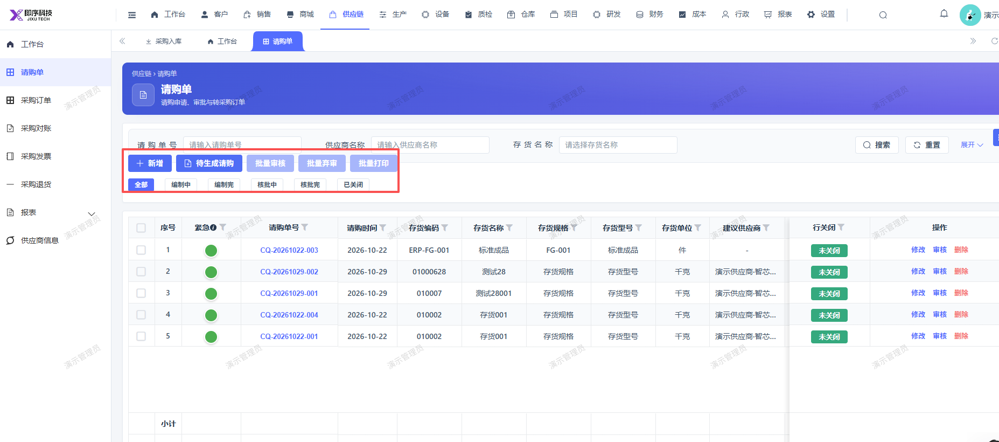
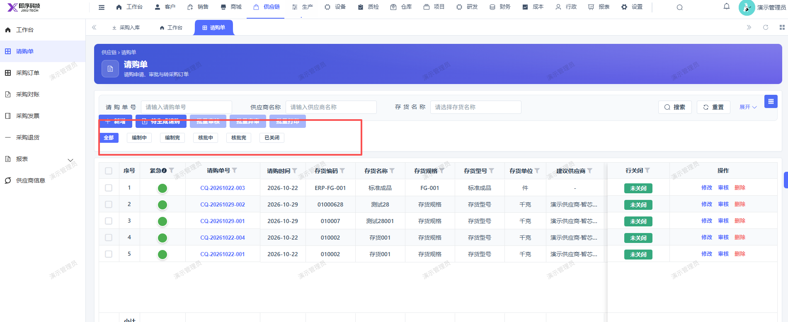

# 请购单页面显示问题，新增和状态筛选这两排整体位置往下

- **优先级**：P2
- **模块 / 页面**：供应链-请购单
- **测试环境**：https://jixu-ai.com/erp/purchase/purchaseRequest
- **提交时间**：2026-10-29 14:43:07（北京时间）
- **状态**：待修复

## 问题描述
请购单页面显示问题，新增和状态筛选这两排整体位置往下，在第二个截图的宽线位置里

## 复现步骤
1，点击供应链
2，点击请购单
3，点击

## 实际结果

## 预期结果

## 截图

