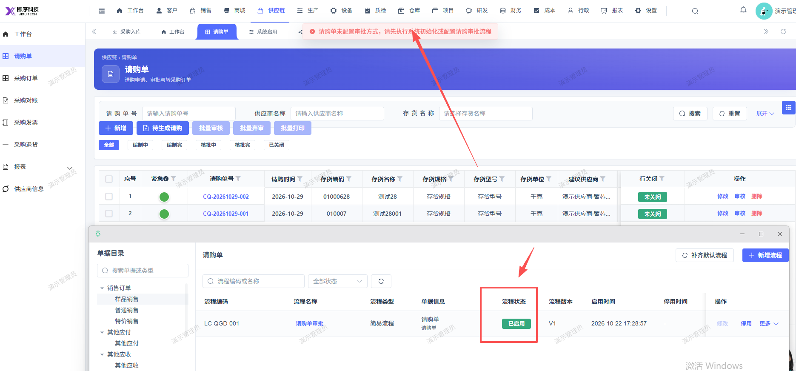

# 请购单无法审核，点击审核报错：请购单未配置审批方式，请先执行系统初始化或配置请购审批流程

- **优先级**：P1
- **模块 / 页面**：供应链-请购单
- **测试环境**：https://jixu-ai.com/erp/purchase/purchaseRequest
- **提交时间**：2026-10-29 15:22:01（北京时间）
- **状态**：待修复

## 问题描述
请购单无法审核，点击审核报错：请购单未配置审批方式，请先执行系统初始化或配置请购审批流程；实际已配置审批流

## 复现步骤
1，点击供应链
2，点击请购单
3，请购单号：CQ-20261029-002，点击 右侧操作栏：审核，报错：请购单未配置审批方式，请先执行系统初始化或配置请购审批流程

## 实际结果

## 预期结果

## 截图

