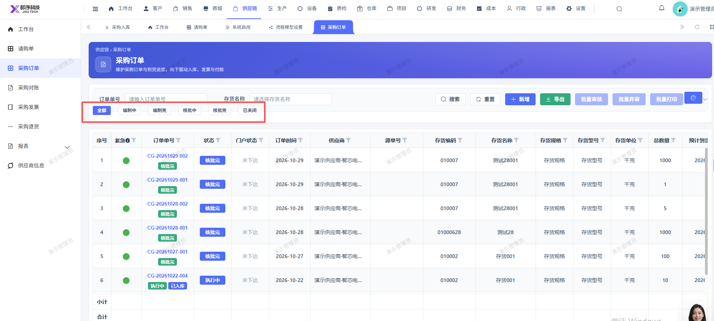
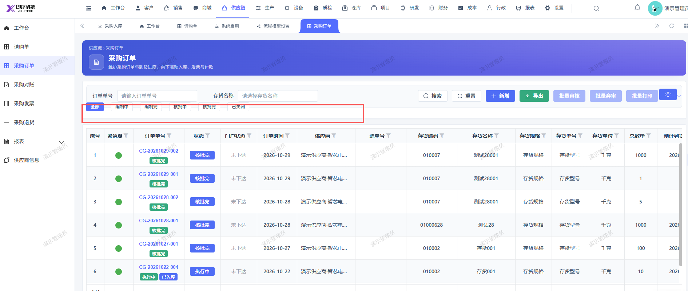

# 采购订单页面的筛选订单状态栏位置调整，整体往下移

- **优先级**：P2
- **模块 / 页面**：供应链-采购订单
- **测试环境**：https://jixu-ai.com/erp/purchase/order
- **提交时间**：2026-10-29 15:36:47（北京时间）
- **状态**：待修复

## 问题描述
采购订单页面的筛选订单状态栏位置调整，整体往下移

## 复现步骤
1，点击供应链
2，点击采购订单，采购订单页面的筛选订单状态栏位置调整，整体往下移

## 实际结果

## 预期结果

## 截图

