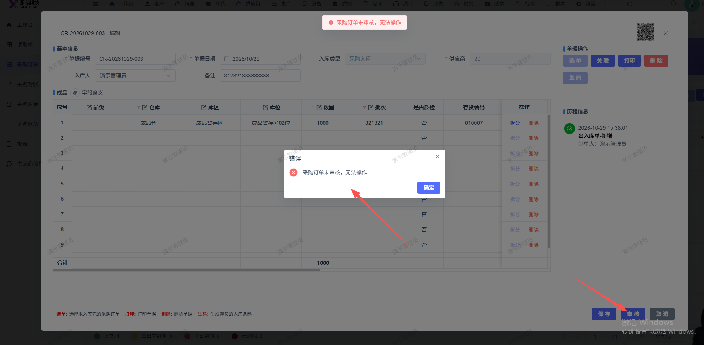
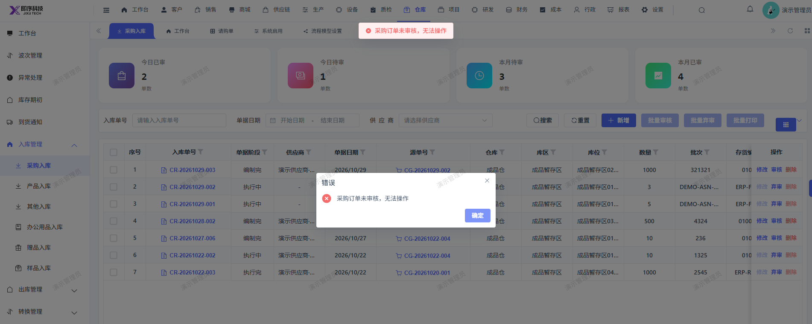

# 采购入库单保存后无法审核，点击审核报错：采购订单未审核，无法操作

- **优先级**：P1
- **模块 / 页面**：仓库-入库管理-采购入库
- **测试环境**：https://jixu-ai.com/erp/purchase/order
- **提交时间**：2026-10-29 15:47:02（北京时间）
- **状态**：待修复

## 问题描述
采购入库单保存后无法审核，点击审核报错：采购订单未审核，无法操作 CG-20261029-002

## 复现步骤
1，点击仓库
2，点击入库管理
3，点击采购入库
4，点击入库单：CR-20261029-003 右侧操作栏 审核 按钮，报错：采购订单未审核，无法操作（实际采购订单已审核）

## 实际结果

## 预期结果

## 截图

