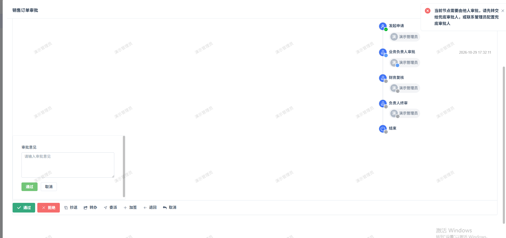
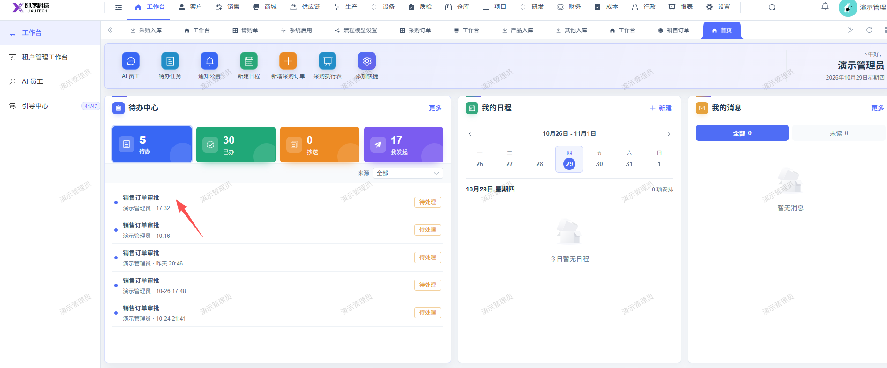

# 销售订单提审后无法审核，审核报错：当前节点需要由他人审批，请先转交给兜底审批人，或联系管理员配置兜底审批人

- **优先级**：P1
- **模块 / 页面**：工作台-工作台
- **测试环境**：https://jixu-ai.com/index
- **提交时间**：2026-10-29 17:35:29（北京时间）
- **状态**：待修复

## 问题描述
销售订单提审后无法审核，审核报错：当前节点需要由他人审批，请先转交给兜底审批人，或联系管理员配置兜底审批人

## 复现步骤
1，点击工作台
2，点击工作台
3，点击时间是：17:32 的销售订单，点击这条单处理
4，在弹窗内点击：通过 报错：当前节点需要由他人审批，请先转交给兜底审批人，或联系管理员配置兜底审批人

## 实际结果

## 预期结果

## 截图

