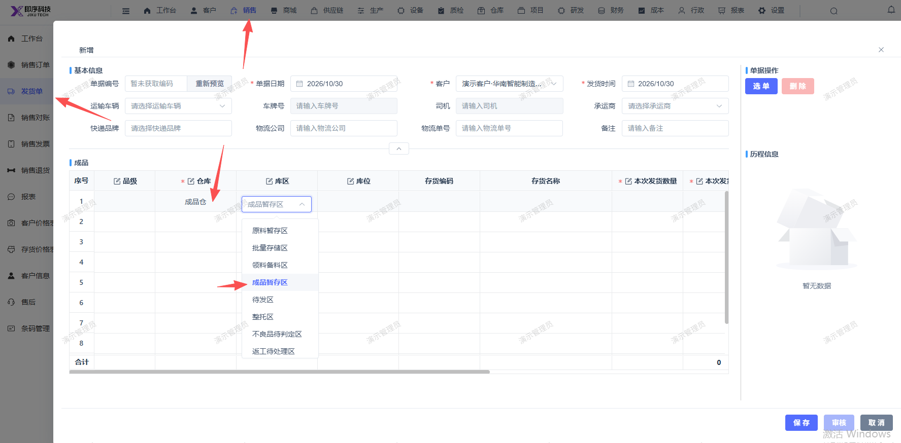
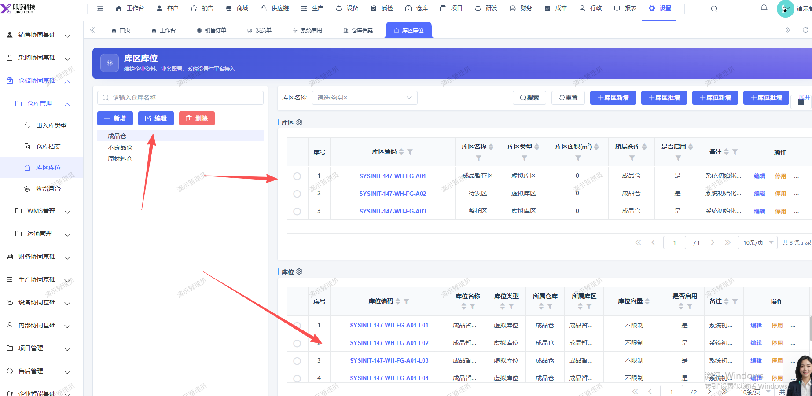

# 新增发货单，选择成品仓后，选择库区库位， 应只显示对应的库区库位，不要把全部显示出来选择

- **优先级**：P2
- **模块 / 页面**：销售-发货单
- **测试环境**：https://jixu-ai.com/erp/sale/delivery
- **提交时间**：2026-10-30 10:13:36（北京时间）
- **状态**：待修复

## 问题描述
新增发货单，选择成品仓后，选择库区库位， 应只显示对应的库区库位，不要把全部显示出来选择

## 复现步骤
1，点击销售
2，点击发货单
3，点击新增，选择成品仓后，选择库区库位， 应只显示对应的库区库位，不要把全部显示出来选择

## 实际结果

## 预期结果

## 截图

