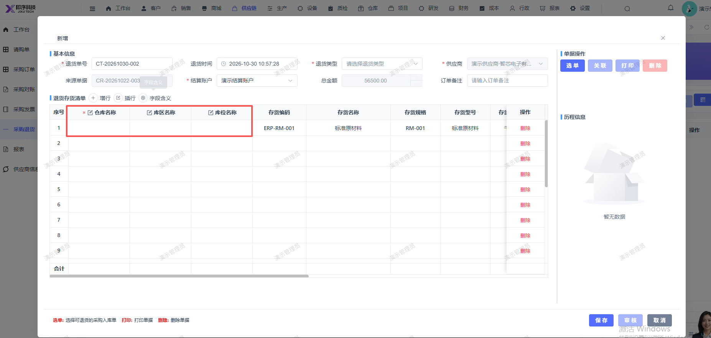

# 新增采购退货单，选择采购订单后，仓库库区库位不显示（鼠标点击后会显示）

- **优先级**：P2
- **模块 / 页面**：供应链-采购退货
- **测试环境**：https://jixu-ai.com/erp/purchase/return
- **提交时间**：2026-10-30 11:01:39（北京时间）
- **状态**：待修复

## 问题描述
新增采购退货单，选择采购订单后，仓库库区库位不显示（鼠标点击后会显示）

## 复现步骤
1点击供应链
2，点击采购退货
3，点击新增，点击选单：CR-20261022-003，点击确定后，页面仓库库区库位不显示（鼠标点击后会显示）

## 实际结果

## 预期结果

## 截图

