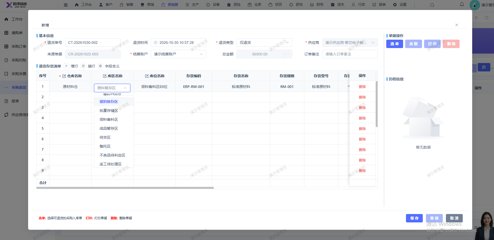

# 采购退货页面选择仓库后，库区库位没有对应下拉显示（现在显示的是所有的库区库位）

- **优先级**：P2
- **模块 / 页面**：供应链-采购退货
- **测试环境**：https://jixu-ai.com/erp/purchase/return
- **提交时间**：2026-10-30 11:04:33（北京时间）
- **状态**：代码已修复，待发布

## 问题描述
采购退货页面选择仓库后，库区库位没有对应下拉显示（现在显示的是所有的库区库位）

## 复现步骤
1，点击供应链
2，点击采购退货
3，点击新增 ，点击仓库成品仓，库区库位没有对应下拉显示（现在显示的是所有的库区库位）

## 实际结果

## 预期结果

## 截图

## 状态同步（Codex，2026-11-06）

- 产品提交：[前端 9d1e52e43](http://192.168.110.240:3008/cfor_front/cfor-admin-vue3/-/commit/9d1e52e431585616f8652ea7f95bef6376076bbc)
- 合入分支：dev/develop_5.0.1；本次已刷新远端并核对提交祖先关系。
- 当前结论：代码已修复，待发布；已有本地验证记录，生产发布和修复后生产复测尚无证据。
- 详细记录：[修改内容、验证及限制](reports/2026-11-06-today-bug-status-sync.md#bug-local-20261105113401-675f0d57)
- 同场景报告：[BUG-local-20261105113401-675f0d57](BUG-local-20261105113401-675f0d57.md)、[BUG-local-20261030110433-ebc9dc07](BUG-local-20261030110433-ebc9dc07.md)；独立编号保留，共用修复说明，不视为各原账号已分别验证。
