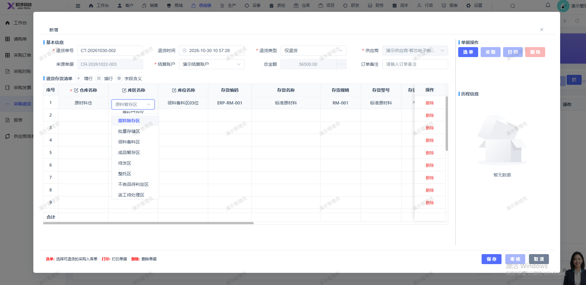

# 采购退货页面选择仓库后，库区库位没有对应下拉显示（现在显示的是所有的库区库位）

- **优先级**：P2
- **模块 / 页面**：供应链-采购退货
- **测试环境**：https://jixu-ai.com/erp/purchase/return
- **提交时间**：2026-10-30 11:04:33（北京时间）
- **状态**：待修复

## 问题描述
采购退货页面选择仓库后，库区库位没有对应下拉显示（现在显示的是所有的库区库位）

## 复现步骤
1，点击供应链
2，点击采购退货
3，点击新增 ，点击仓库成品仓，库区库位没有对应下拉显示（现在显示的是所有的库区库位）

## 实际结果

## 预期结果

## 截图

