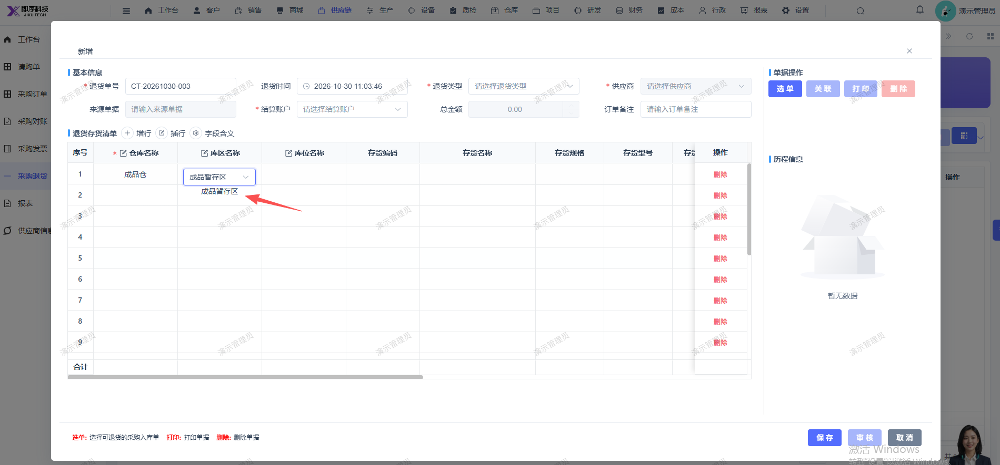
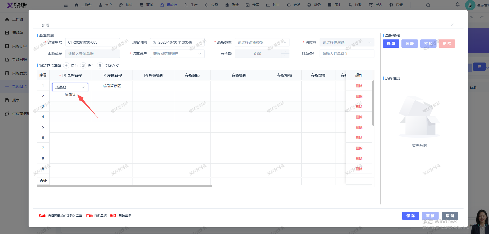

# 新增采购退货页面，选择仓库库区库位，选中后鼠标未移开框线下面会多显示一个库区/库位/仓库

- **优先级**：P2
- **模块 / 页面**：供应链-采购退货
- **测试环境**：https://jixu-ai.com/erp/purchase/return
- **提交时间**：2026-10-30 11:09:58（北京时间）
- **状态**：待修复

## 问题描述
新增采购退货页面，选择仓库库区库位，选中后鼠标未移开框线下面会多显示一个库区/库位/仓库

## 复现步骤
1，点击供应链
2，点击采购退货
3，点击新增，选择仓库库区库位，选中后鼠标未移开框线下面会多显示一个库区/库位/仓库

## 实际结果

## 预期结果

## 截图

