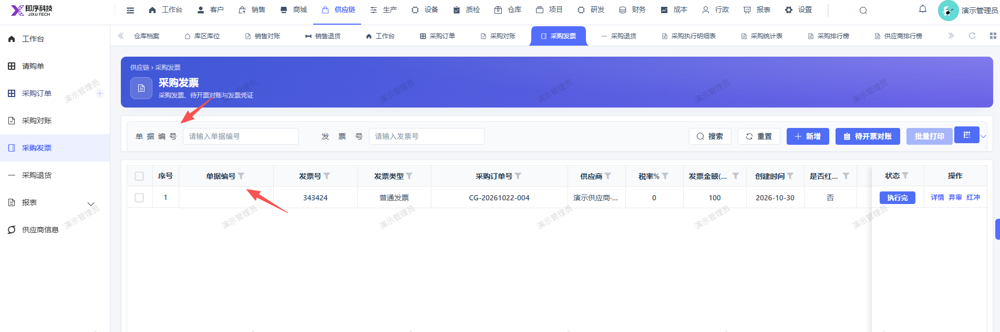

# 采购发票列表顶部的筛选项去掉：单据编号

- **优先级**：P2
- **模块 / 页面**：供应链-采购发票
- **测试环境**：https://jixu-ai.com/erp/purchase/invoice
- **提交时间**：2026-10-30 14:35:57（北京时间）
- **状态**：待修复

## 问题描述
采购发票列表顶部的筛选项去掉：单据编号

## 复现步骤
1，点击供应链
2，点击采购发票，列表顶部的筛选项去掉：单据编号

## 实际结果

## 预期结果

## 截图

