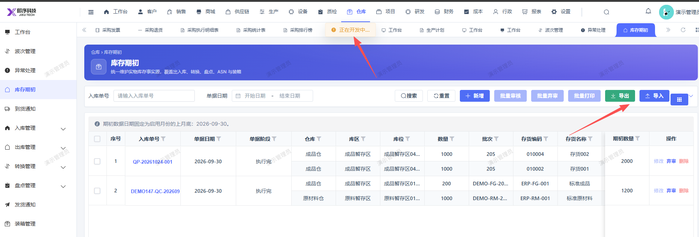

# 库存期初无法导出，点击导出提示：正在开发中

- **优先级**：P2
- **模块 / 页面**：仓库-库存期初
- **测试环境**：https://jixu-ai.com/wireSideWarehouse/beginningInventory
- **提交时间**：2026-10-30 14:59:59（北京时间）
- **状态**：待修复

## 问题描述
库存期初无法导出，点击导出提示：正在开发中

## 复现步骤
1，点击仓库
2，点击库存期初
3，点击筛选栏：导出  提示：正在开发中

## 实际结果

## 预期结果

## 截图

