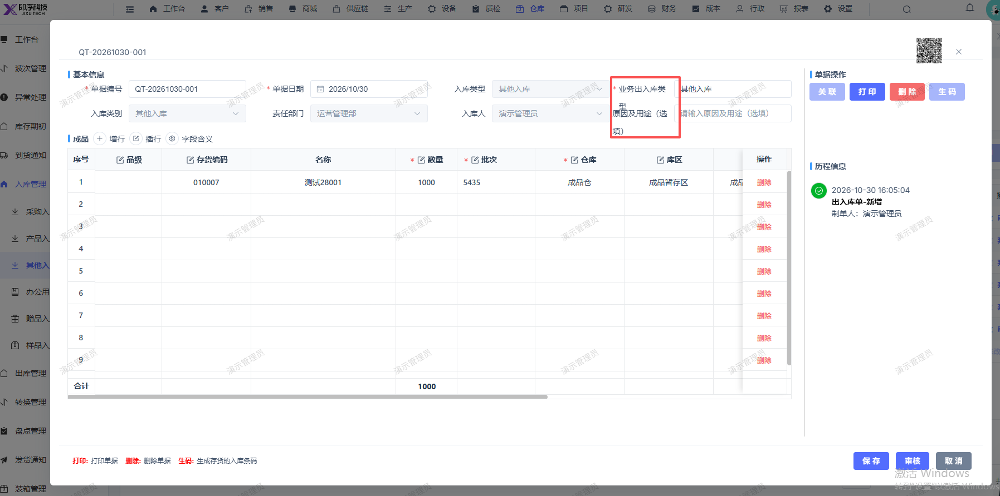

# 其他入库单详情的业务出入库类型和原因及用途（选填）换行和字重叠 显示了

- **优先级**：P2
- **模块 / 页面**：仓库-入库管理-其他入库
- **测试环境**：https://jixu-ai.com/wireSideWarehouse/in/inOther
- **提交时间**：2026-10-30 16:11:09（北京时间）
- **状态**：待修复

## 问题描述
其他入库单详情的业务出入库类型和原因及用途（选填）换行和字重叠 显示了

## 复现步骤
1，点击仓库
2，点击入库管理
3，其他入库，列表点击入库单号：QT-20261030-001，详情的业务出入库类型和原因及用途（选填）换行和字重叠 显示了

## 实际结果

## 预期结果

## 截图

