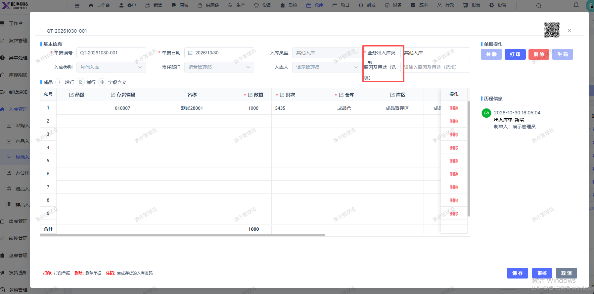

# 其他入库单详情的业务出入库类型和原因及用途（选填）换行和字重叠 显示了

- **优先级**：P2
- **模块 / 页面**：仓库-入库管理-其他入库
- **测试环境**：https://jixu-ai.com/wireSideWarehouse/in/inOther
- **提交时间**：2026-10-30 16:11:09（北京时间）
- **状态**：代码已修复，待发布

## 问题描述
其他入库单详情的业务出入库类型和原因及用途（选填）换行和字重叠 显示了

## 复现步骤
1，点击仓库
2，点击入库管理
3，其他入库，列表点击入库单号：QT-20261030-001，详情的业务出入库类型和原因及用途（选填）换行和字重叠 显示了

## 实际结果

## 预期结果

## 截图

## 状态同步（Codex，2026-11-06）

- 产品提交：[前端 6d87afe57](http://192.168.110.240:3008/cfor_front/cfor-admin-vue3/-/commit/6d87afe5713468d43bc3529e4c8201bcc88d910a)
- 合入分支：dev/develop_5.0.1；本次已刷新远端并核对提交祖先关系。
- 当前结论：代码已修复，待发布；已有本地验证记录，生产发布和修复后生产复测尚无证据。
- 详细记录：[修改内容、验证及限制](reports/2026-11-06-today-bug-status-sync.md#bug-local-20261030161109-b95b3155)
