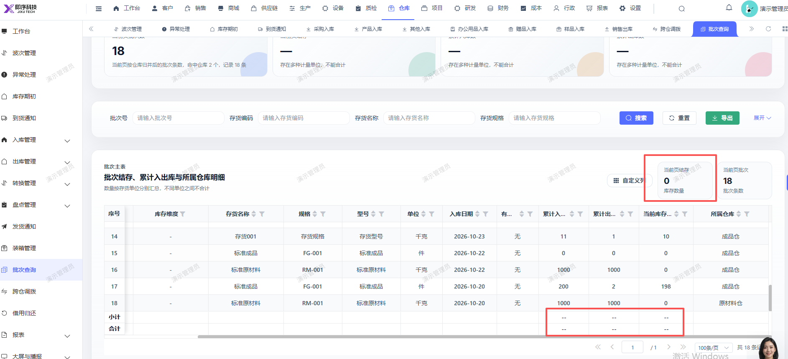

# 批次查询页面，合计小计以及当前页结存库存数量未显示

- **优先级**：P2
- **模块 / 页面**：仓库-批次查询
- **测试环境**：https://jixu-ai.com/wireSideWarehouse/batch
- **提交时间**：2026-10-30 16:28:31（北京时间）
- **状态**：待修复

## 问题描述
批次查询页面，合计小计以及当前页结存库存数量未显示

## 复现步骤
1，点击仓库
2，点击批次查询，合计小计以及当前页结存库存数量未显示

## 实际结果

## 预期结果

## 截图

