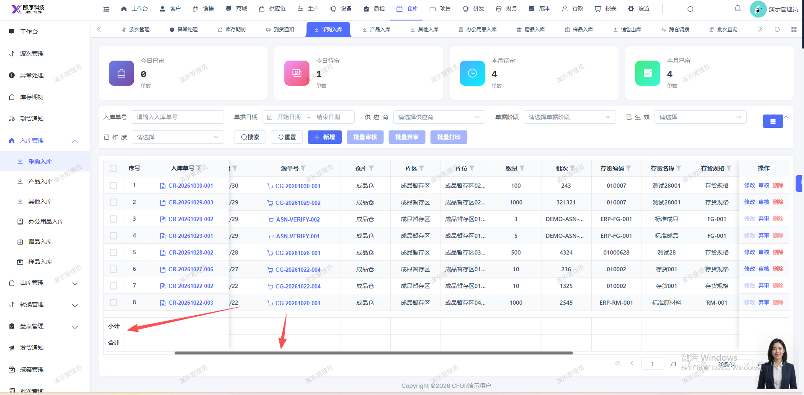

# 采购入库页面的合计小计应是固定左侧，现拖动下面的拖动条往右边拉，会往左变位置至看不见

- **优先级**：P2
- **模块 / 页面**：仓库-入库管理-采购入库
- **测试环境**：https://jixu-ai.com/wireSideWarehouse/in/inPurchase
- **提交时间**：2026-10-30 16:39:21（北京时间）
- **状态**：待修复

## 问题描述
采购入库页面的合计小计应是固定左侧，现拖动下面的拖动条往右边拉，会往左变位置至看不见

## 复现步骤
1，点击仓库
2，点击入库管理
3，点击采购入库，页面的合计小计应是固定左侧，现拖动下面的拖动条往右边拉，会往左变位置至看不见

## 实际结果

## 预期结果

## 截图

