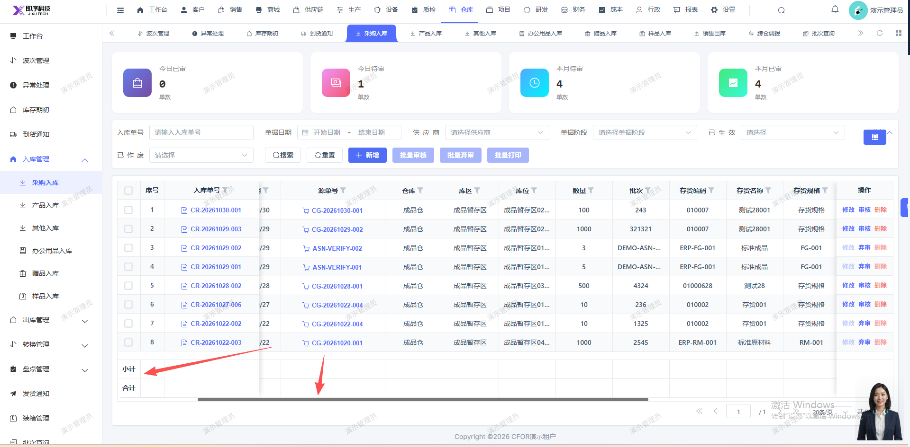

# 采购入库页面的合计小计应是固定左侧，现拖动下面的拖动条往右边拉，会往左变位置至看不见

- **优先级**：P2
- **模块 / 页面**：仓库-入库管理-采购入库
- **测试环境**：https://jixu-ai.com/wireSideWarehouse/in/inPurchase
- **提交时间**：2026-10-30 16:39:21（北京时间）
- **状态**：代码已修复，待发布

## 问题描述
采购入库页面的合计小计应是固定左侧，现拖动下面的拖动条往右边拉，会往左变位置至看不见

## 复现步骤
1，点击仓库
2，点击入库管理
3，点击采购入库，页面的合计小计应是固定左侧，现拖动下面的拖动条往右边拉，会往左变位置至看不见

## 实际结果

## 预期结果

## 截图

## 状态同步（Codex，2026-11-06）

- 产品提交：[前端 5b01d9e30](http://192.168.110.240:3008/cfor_front/cfor-admin-vue3/-/commit/5b01d9e308e19216dce05ee88ed0f7fc67c668a6)
- 合入分支：dev/develop_5.0.1；本次已刷新远端并核对提交祖先关系。
- 当前结论：代码已修复，待发布；已有本地验证记录，生产发布和修复后生产复测尚无证据。
- 详细记录：[修改内容、验证及限制](reports/2026-11-06-today-bug-status-sync.md#bug-local-20261030163921-53f13553)
