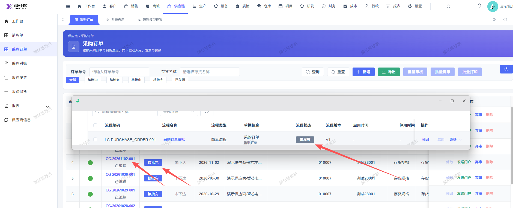
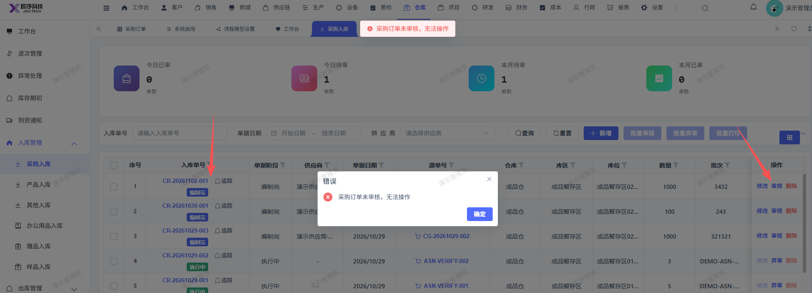

# 采购订单已审批完成，采购入库单提审时报：采购订单未审核，无法操作

- **优先级**：P1
- **模块 / 页面**：
- **测试环境**：
- **提交时间**：2026-11-02 14:36:11（北京时间）
- **状态**：待修复

## 问题描述
采购订单已审批完成，采购入库单提审时报：采购订单未审核，无法操作

## 复现步骤
1，点击仓库
2，点击入库管理
3，点击采购入库
4，入库单号： ，点击右侧操作：审核，报错：采购订单未审核，无法操作（实际已审批完成）

## 实际结果

## 预期结果

## 截图

