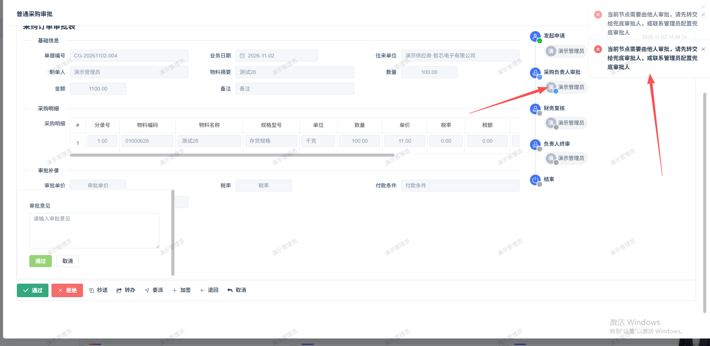

# 采购订单审核，点击通过报错：当前节点需要由他人审批，请先转交给兜底审批人，或联系管理员配置兜底审批人

- **优先级**：P1
- **模块 / 页面**：工作台-工作台-待办中心
- **测试环境**：https://jixu-ai.com/index
- **提交时间**：2026-11-02 14:47:59（北京时间）
- **状态**：待修复

## 问题描述
采购订单审核，点击通过报错：当前节点需要由他人审批，请先转交给兜底审批人，或联系管理员配置兜底审批人

## 复现步骤
1，点击工作台
2，点击工作台
3，在待办中心，点击2026.11.2  14.44的普通采购审核
4，点击通过
5，再点击通过，报错：当前节点需要由他人审批，请先转交给兜底审批人，或联系管理员配置兜底审批人（当前审批人就是登录人）

## 实际结果

## 预期结果

## 截图

