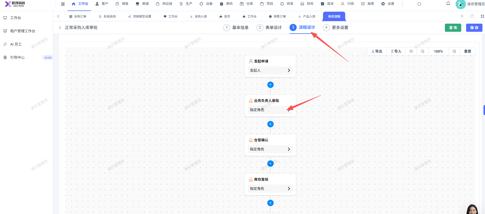
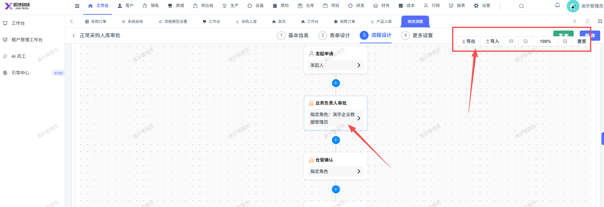
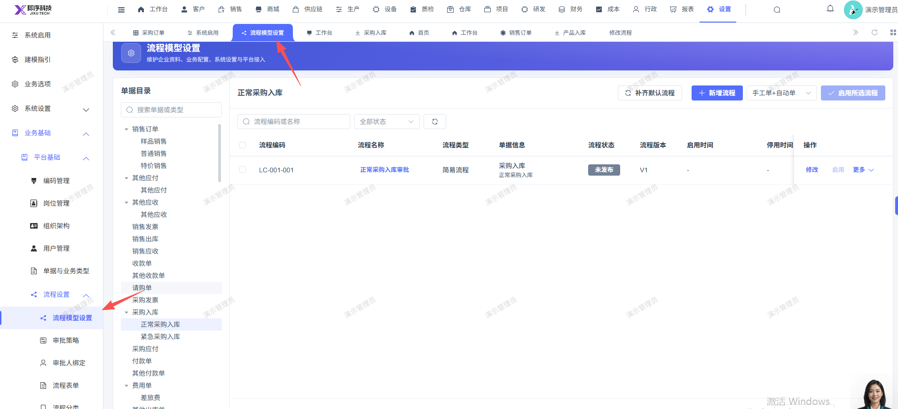

# 流程模型设置进行修改流程修改指定角色保存后，右上角的 导出导入... 那一排鼠标往下移动会跟 保存发布 按钮重叠

- **优先级**：P2
- **模块 / 页面**：设置-业务基础-平台基础-流程设置
- **测试环境**：https://jixu-ai.com/settings/bpm/model-settings
- **提交时间**：2026-11-02 15:39:45（北京时间）
- **状态**：代码已修复，待发布

## 问题描述
流程模型设置进行修改流程修改指定角色保存后，右上角的 导出导入... 那一排鼠标往下移动会跟 保存发布 按钮重叠

## 复现步骤
1，点击设置
2，点击业务基础
3，点击平台基础
4，点击流程设置
5，点击 正常采购入库单  操作 修改
6，点击 流程设计
7，点击 指定角色
8，修改指定角色为：演示企业数据管理员；启用开关
9，点击确定
10，移动鼠标：右上角的 导出导入... 那一排鼠标往下移动会跟 保存发布 按钮重叠

## 实际结果

## 预期结果

## 截图

## 状态同步（Codex，2026-11-06）

- 产品提交：[前端 915c40dc0](http://192.168.110.240:3008/cfor_front/cfor-admin-vue3/-/commit/915c40dc0db68dc013f12b646900052724734060)
- 合入分支：dev/develop_5.0.1；本次已刷新远端并核对提交祖先关系。
- 当前结论：代码已修复，待发布；已有本地验证记录，生产发布和修复后生产复测尚无证据。
- 详细记录：[修改内容、验证及限制](reports/2026-11-06-today-bug-status-sync.md#bug-local-20261102153945-344984ef)
