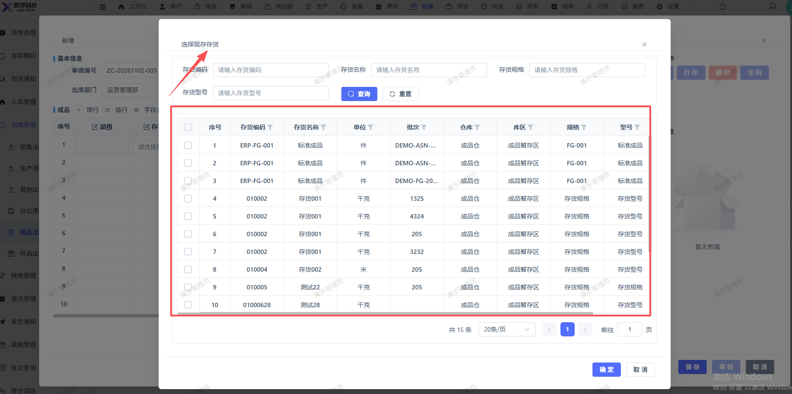

# 赠品出库应只能选择赠品入库的存货进行出库，现在会把所有的存货显示出来选择

- **优先级**：P2
- **模块 / 页面**：仓库-出库管理-赠品出库
- **测试环境**：https://jixu-ai.com/wireSideWarehouse/out/outGift
- **提交时间**：2026-11-02 16:39:10（北京时间）
- **状态**：代码已修复，待发布

## 问题描述
赠品出库应只能选择赠品入库的存货进行出库，现在会把所有的存货显示出来选择

## 复现步骤
1，点击仓库
2，点击出库管理
3，点击赠品出库
4，点击新增，在弹窗内点击存货编码 选择存货 ，应只能选择赠品入库的存货进行出库，现在会把所有的存货显示出来选择

## 实际结果

## 预期结果

## 截图

## 状态同步（Codex，2026-11-06）

- 产品提交：[前端 50f67d92f](http://192.168.110.240:3008/cfor_front/cfor-admin-vue3/-/commit/50f67d92f1b9dafe2f841e4ca070759e341a1ff3)、[后端 4a0716a79](http://192.168.110.240:3008/cfor_backend/cfor-admin/-/commit/4a0716a79b04b0f154b1655cdfa5fbb6ce7fff91)
- 合入分支：dev/develop_5.0.1；本次已刷新远端并核对提交祖先关系。
- 当前结论：代码已修复，待发布；已有本地验证记录，生产发布和修复后生产复测尚无证据。
- 详细记录：[修改内容、验证及限制](reports/2026-11-06-today-bug-status-sync.md#bug-local-20261102163910-6046e9b0)
