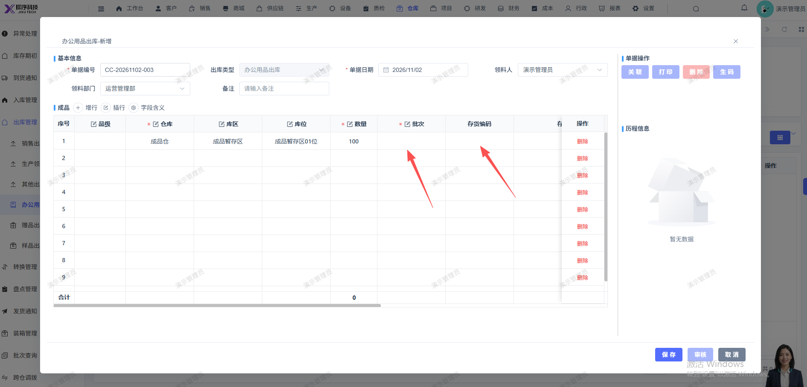

# 办公用品出库单，点击新增后，点击批次无反应，无法选择存货出库新建办公用品出库单

- **优先级**：P1
- **模块 / 页面**：仓库-出库管理-办公用品出库
- **测试环境**：https://jixu-ai.com/wireSideWarehouse/out/outMaterial
- **提交时间**：2026-11-02 16:45:09（北京时间）
- **状态**：待修复

## 问题描述
办公用品出库单，点击新增后，点击批次无反应，无法选择存货出库新建办公用品出库单

## 复现步骤
1，点击仓库
2，点击出库管理
3，点击办公用品出库
4，点击新增，在弹窗内，点击批次无反应，无法选择存货出库新建办公用品出库单

## 实际结果

## 预期结果

## 截图

