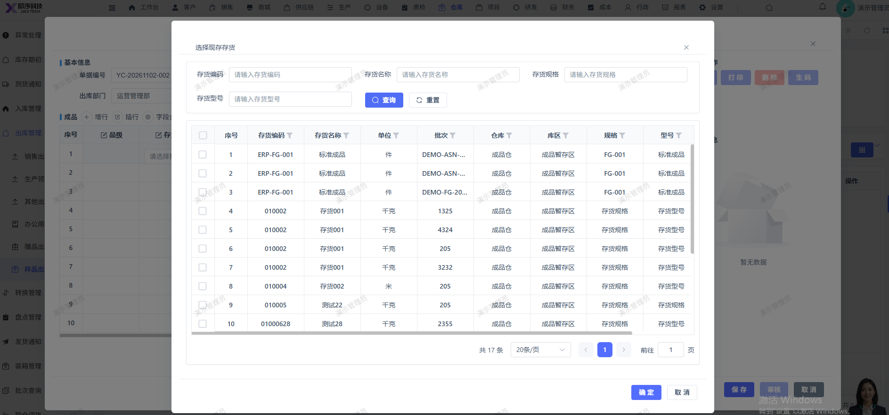

# 样品出库新增，应只能选择样品入库的存货进行出库，现在选择存货会把所有的存货显示出来选择

- **优先级**：P2
- **模块 / 页面**：仓库-出库管理-样品出库
- **测试环境**：https://jixu-ai.com/wireSideWarehouse/out/outSample
- **提交时间**：2026-11-02 17:11:25（北京时间）
- **状态**：已验证（线上来源筛选及选货回填场景通过）

## 问题描述
样品出库新增，应只能选择样品入库的存货进行出库，现在选择存货会把所有的存货显示出来选择

## 复现步骤
1，仓库
2，点击出库管理
3，点击样品出库
4，点击新增，应只能选择样品入库的存货进行出库，现在选择存货会把所有的存货显示出来选择

## 实际结果

## 预期结果

## 截图

## 修复记录（Codex，2026-11-06）

- 产品提交：[前端 457e456c2](http://192.168.110.240:3008/cfor_front/cfor-admin-vue3/-/commit/457e456c265bea4c5ba4465356b3bacf6d5d37d3)、[后端 98c79b6ab](http://192.168.110.240:3008/cfor_backend/cfor-admin/-/commit/98c79b6ab067e1a853018d7e5fdb54dc92db674b)
- 合入分支：dev/develop_5.0.1
- 处理结果：Codex 于 2026-11-05 在演示租户对照普通选货 20 条，样品选货仅返回 01000628 / 批次 2355 / 100 千克，并与样品入库来源匹配；选中后物料及仓储信息正常回填。表单取消，未保存、审核或扣减库存；未覆盖全部历史维度边界。
- 详细记录：[原因、修改及验证范围](reports/2026-11-06-merged-bug-fixes.md#bug-local-20261102171125-01e28e7d)
