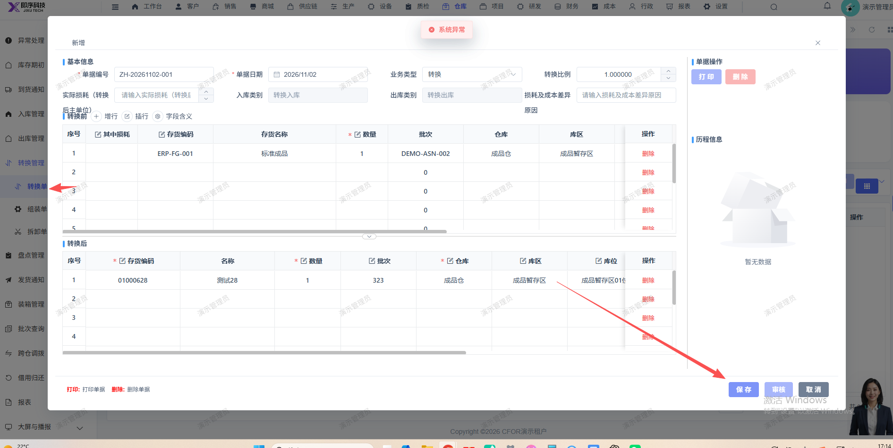

# 新增转换单，点击保存后报：系统异常

- **优先级**：P1
- **模块 / 页面**：仓库-转换管理-转换单
- **测试环境**：https://jixu-ai.com/wireSideWarehouse/convert/convertReceipt
- **提交时间**：2026-11-02 17:16:21（北京时间）
- **状态**：待修复

## 问题描述
新增转换单，点击保存后报：系统异常

## 复现步骤
1，点击仓库
2，点击转换管理
3，点击转换单
4，点击新增，填写完页面信息后，点击保存，报错：系统异常

## 实际结果

## 预期结果

## 截图

