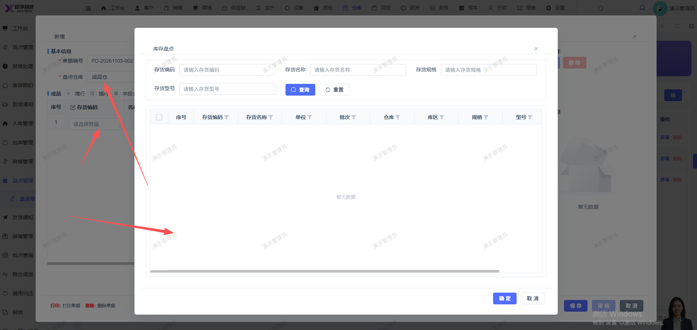

# 新增盘点单，选择成品仓，点击选择存货时，无存货显示，无法新建单

- **优先级**：P1
- **模块 / 页面**：仓库-盘点管理-盘点录入
- **测试环境**：https://jixu-ai.com/wireSideWarehouse/checkBusiness/entries
- **提交时间**：2026-11-03 11:19:15（北京时间）
- **状态**：待修复

## 问题描述
新增盘点单，选择成品仓，点击选择存货时，无存货显示，无法新建单

## 复现步骤
1，点击仓库
2，点击盘点管理
3，点击盘点录入
4，点击新增，在弹窗内选择：成品仓，点击选择存货时，无存货显示，无法新建单

## 实际结果

## 预期结果

## 截图

