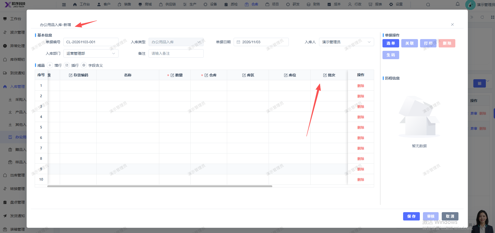
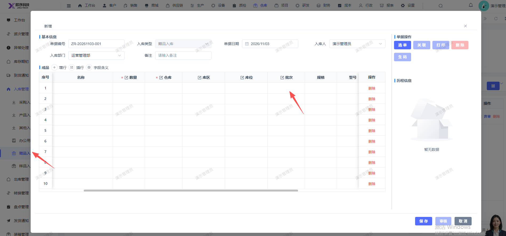
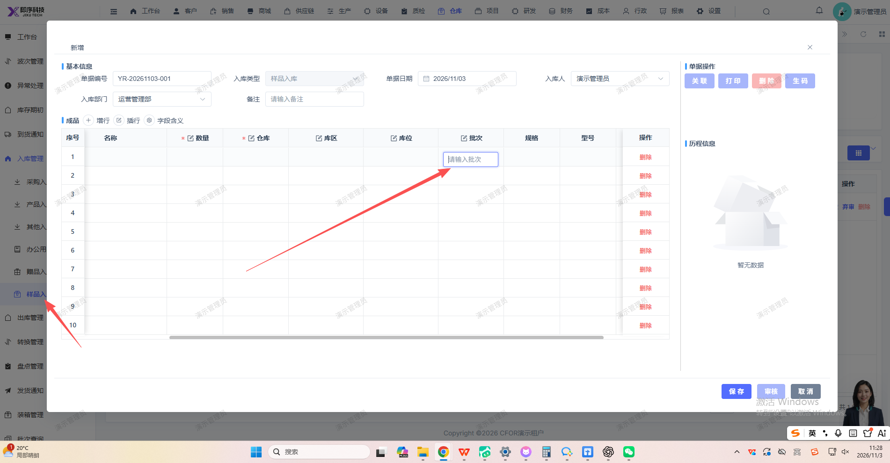

# 新增办公用品入库，赠品入库，样品入库，批次应必填

- **优先级**：P2
- **模块 / 页面**：仓库-入库管理
- **测试环境**：https://jixu-ai.com/wireSideWarehouse/in/inSample
- **提交时间**：2026-11-03 11:30:49（北京时间）
- **状态**：待修复

## 问题描述
新增办公用品入库，赠品入库，样品入库，批次应必填

## 复现步骤
1，点击仓库
2，点击入库管理
3，点击办公用品入库，新增单据时 批次 应必填
4，点击赠品入库，新增单据时 批次 应必填
5，点击样品入库，新增单据时 批次 应必填

## 实际结果

## 预期结果

## 截图

