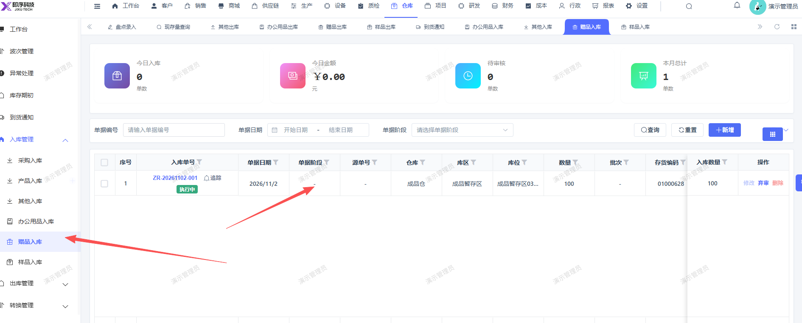
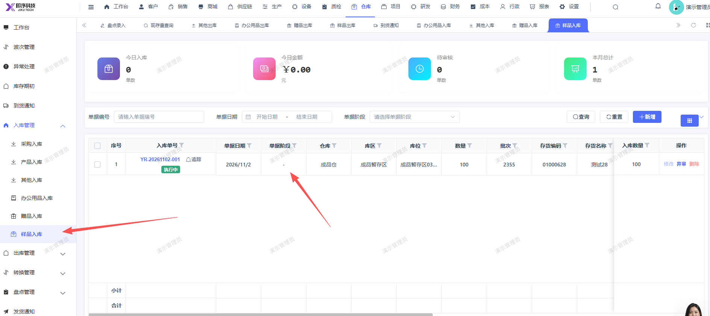

# 赠品入库，样品入库列表，单据阶段未显示

- **优先级**：P2
- **模块 / 页面**：仓库-入库管理
- **测试环境**：https://jixu-ai.com/wireSideWarehouse/in/inSample
- **提交时间**：2026-11-03 11:34:43（北京时间）
- **状态**：代码已修复，待发布

## 问题描述
赠品入库，样品入库列表，单据阶段未显示

## 复现步骤
1，点击仓库
2，点击入库管理
3，点击赠品入库，列表，单据阶段未显示
4，点击样品入库，列表，单据阶段未显示

## 实际结果

## 预期结果

## 截图

## 状态同步（Codex，2026-11-06）

- 产品提交：[前端 39353d5a9](http://192.168.110.240:3008/cfor_front/cfor-admin-vue3/-/commit/39353d5a97f87a0830c8923cc4c160afebc5c8ec)
- 合入分支：dev/develop_5.0.1；本次已刷新远端并核对提交祖先关系。
- 当前结论：代码已修复，待发布；已有本地验证记录，生产发布和修复后生产复测尚无证据。
- 详细记录：[修改内容、验证及限制](reports/2026-11-06-today-bug-status-sync.md#bug-local-20261103113443-83d0e77c)
