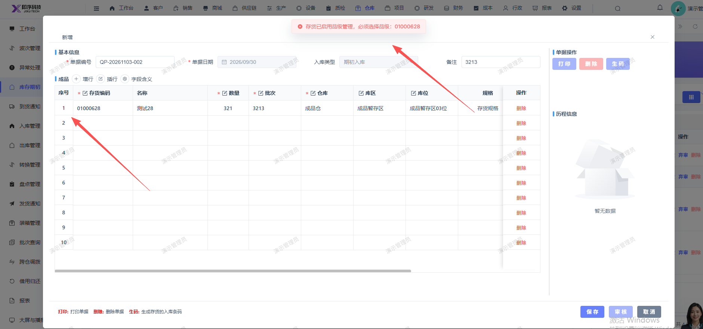

# 新增库存期初时报错：存货已启用品级管理，必须选择品级：01000628，弹窗页面无选择品级入口

- **优先级**：P2
- **模块 / 页面**：仓库-库存期初
- **测试环境**：https://jixu-ai.com/wireSideWarehouse/beginningInventory
- **提交时间**：2026-11-03 15:42:36（北京时间）
- **状态**：待修复

## 问题描述
新增库存期初时报错：存货已启用品级管理，必须选择品级：01000628，弹窗页面无选择品级入口

## 复现步骤
1，点击仓库
2，点击库存期初
3，新增，选中存货：01000628，填写完其他信息，保存报错：存货已启用品级管理，必须选择品级：01000628，弹窗页面无选择品级入口

## 实际结果

## 预期结果

## 截图

