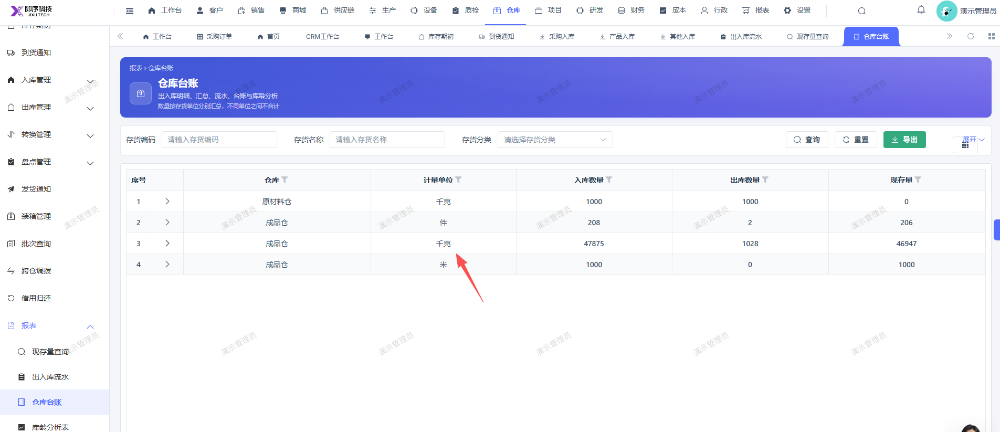

# 仓库台账报表，按仓库区分显示，外层应不显示：计量单位

- **优先级**：P2
- **模块 / 页面**：仓库-仓库台账
- **测试环境**：https://jixu-ai.com/wireSideWarehouse/reportForms/warehouseLedger
- **提交时间**：2026-11-03 16:07:18（北京时间）
- **状态**：待修复

## 问题描述
仓库台账报表，按仓库区分显示，外层应不显示：计量单位

## 复现步骤
1，点击仓库
2，点击报表
3，点击仓库台账，外层的列表不显示：计量单位

## 实际结果

## 预期结果

## 截图

