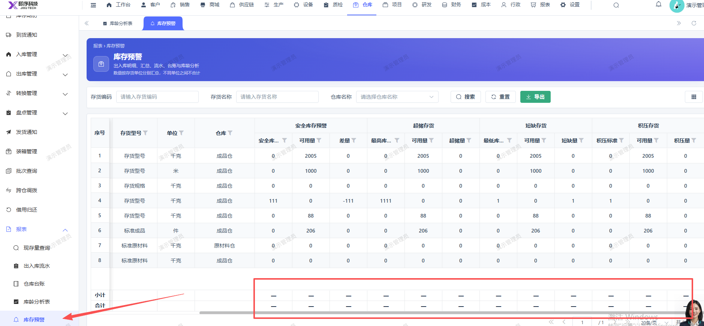

# 库存预警报表，页面下方的合计小计会显示

- **优先级**：P2
- **模块 / 页面**：仓库-报表
- **测试环境**：https://jixu-ai.com/wireSideWarehouse/reportForms/inventoryAlerts
- **提交时间**：2026-11-03 16:56:52（北京时间）
- **状态**：待修复

## 问题描述
库存预警报表，页面下方的合计小计会显示

## 复现步骤
1，点击仓库
2，点击报表
3，点击库存预警，页面下方的合计小计会显示

## 实际结果

## 预期结果

## 截图

