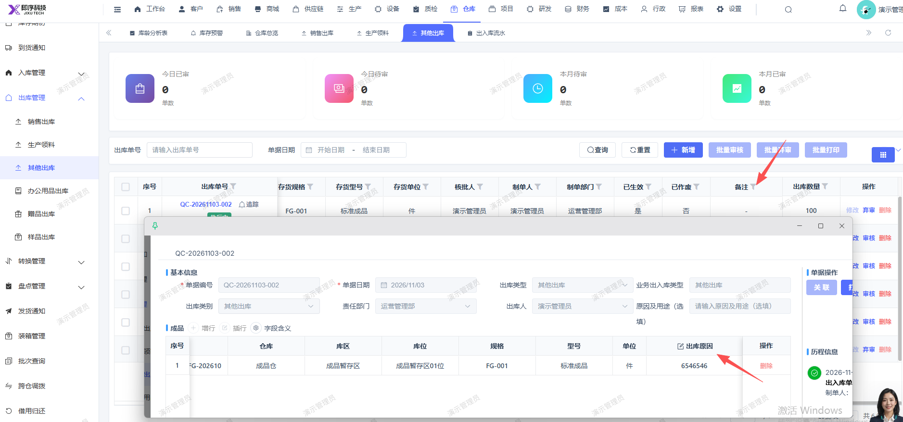

# 其他出库单列表的备注未显示，应显示对应单据的出库原因

- **优先级**：P2
- **模块 / 页面**：仓库-出库管理
- **测试环境**：https://jixu-ai.com/wireSideWarehouse/out/outOther
- **提交时间**：2026-11-03 17:23:26（北京时间）
- **状态**：代码已修复，待发布

## 问题描述
其他出库单列表的备注未显示，应显示对应单据的出库原因

## 复现步骤
1，点击仓库
2，点击出库管理
3，搜索出库单号：QC-20261103-002，拖动页面至最后面，备注未显示，应显示对应单据的出库原因

## 实际结果

## 预期结果

## 截图

## 状态同步（Codex，2026-11-06）

- 产品提交：[前端 bc09d55cf](http://192.168.110.240:3008/cfor_front/cfor-admin-vue3/-/commit/bc09d55cf3d7f07e36b8f5d4bef4461615583266)
- 合入分支：dev/develop_5.0.1；本次已刷新远端并核对提交祖先关系。
- 当前结论：代码已修复，待发布；已有本地验证记录，生产发布和修复后生产复测尚无证据。
- 详细记录：[修改内容、验证及限制](reports/2026-11-06-today-bug-status-sync.md#bug-local-20261103172326-9ea386cd)
