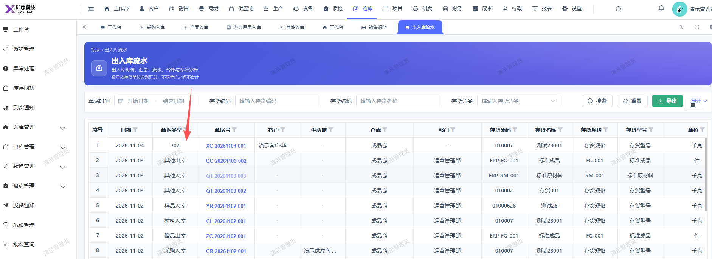
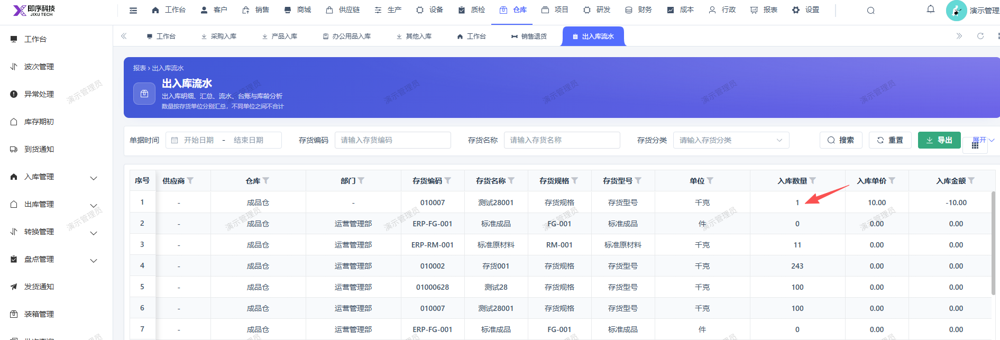

# 出入库流水报表显示的销售退货的单据 类型未正确显示以及入库数量应显示-1

- **优先级**：P2
- **模块 / 页面**：仓库-报表
- **测试环境**：https://jixu-ai.com/wireSideWarehouse/reportForms/inOutStream
- **提交时间**：2026-11-04 11:38:13（北京时间）
- **状态**：待修复

## 问题描述
出入库流水报表显示的销售退货的单据 类型未正确显示以及入库数量应显示-1

## 复现步骤
1，点击仓库
2，点击报表
3，点击出入库流程，找到2026-11-04单据号是XC-20261104-001的单据，单据 类型未正确显示以及入库数量应显示-1

## 实际结果

## 预期结果

## 截图

