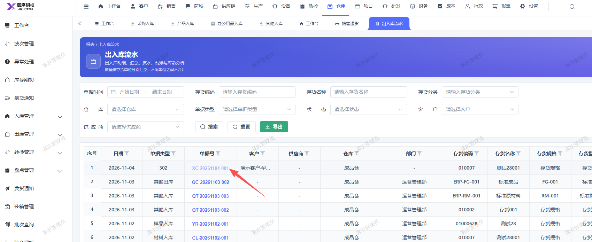

# 出入库流水报表销售退货单据，点击单据号无反应，未弹窗显示详情

- **优先级**：P2
- **模块 / 页面**：仓库-报表
- **测试环境**：https://jixu-ai.com/wireSideWarehouse/reportForms/inOutStream
- **提交时间**：2026-11-04 11:39:54（北京时间）
- **状态**：代码已修复，待发布

## 问题描述
出入库流水报表销售退货单据，点击单据号无反应，未弹窗显示详情

## 复现步骤
1，点击仓库
2，点击报表
3，点击出入库流程，找到2026-11-04单据号是XC-20261104-001的单据，点击单据号无反应，未弹窗显示详情

## 实际结果

## 预期结果

## 截图

## 修复记录（Codex，2026-11-06）

- 产品提交：[前端 241a8c6e8](http://192.168.110.240:3008/cfor_front/cfor-admin-vue3/-/commit/241a8c6e8d6c179afb2089dd5260843982ad5628)
- 合入分支：dev/develop_5.0.1
- 处理结果：代码已修复并合入开发分支，本地验证结果及限制见逐项记录；尚未核实生产发布或复测。
- 配置说明：2026-11-05 已按用户授权通过本地及线上字典页面补齐 stock_io_type 的 302、bill_type 的 MesStkIo:302，标签均为销售退货且启用；原 SalReturn 保留。线上名称显示及类型查询已核对，此配置不随 Git 提交分发，不能据此声称详情入口代码已在生产验证。
- 详细记录：[原因、修改及验证范围](reports/2026-11-06-merged-bug-fixes.md#bug-local-20261104113954-526ff1b9)
