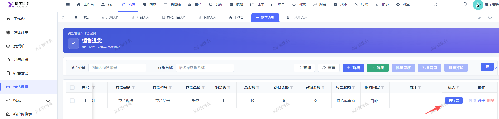
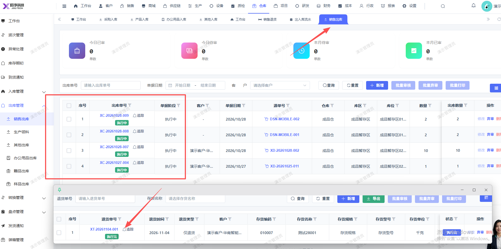

# 销售退货审核完成（仅退货类型）， 销售出库未显示对应的销售出库单

- **优先级**：P1
- **模块 / 页面**：仓库-出库管理-销售出库
- **测试环境**：https://jixu-ai.com/wireSideWarehouse/out/outSell
- **提交时间**：2026-11-04 11:44:18（北京时间）
- **状态**：待修复

## 问题描述
销售退货审核完成（仅退货类型）， 销售出库未显示对应的销售出库单

## 复现步骤
1，点击仓库
2，点击出库管理
3，点击销售出库，销售退货审核完成（退货单：XT-20261104-001）， 销售出库未显示对应的销售出库单

## 实际结果

## 预期结果

## 截图

