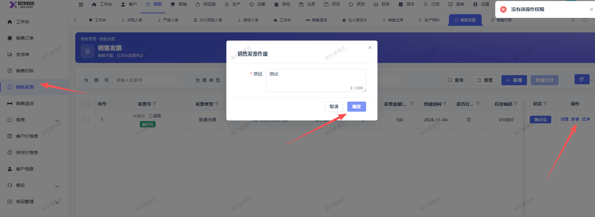

# 销售发票弃审，确定时提示：没有该操作权限

- **优先级**：P2
- **模块 / 页面**：销售-销售发票
- **测试环境**：https://jixu-ai.com/erp/sale/invoice
- **提交时间**：2026-11-04 15:19:36（北京时间）
- **状态**：待修复

## 问题描述
销售发票弃审，确定时提示：没有该操作权限

## 复现步骤
1，点击销售
2，点击销售发票
3，点击单据右侧操作：弃审，在页面填写原因后，点击确定  报错：没有该操作权限

## 实际结果

## 预期结果

## 截图

