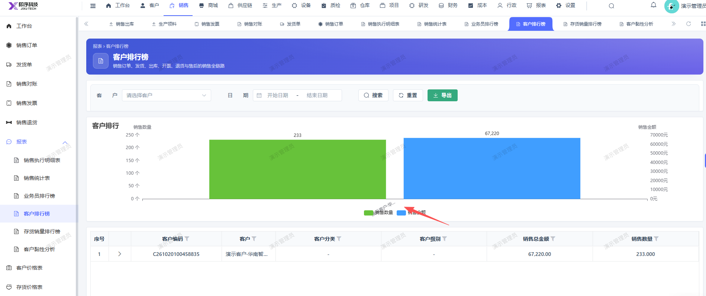

# 客户排行榜报表，客户排行的图表：销售数量和客户名称重叠了

- **优先级**：P2
- **模块 / 页面**：销售-报表
- **测试环境**：https://jixu-ai.com/erp/sale/saleReportForm/customerRanking
- **提交时间**：2026-11-04 16:17:00（北京时间）
- **状态**：代码已修复，待发布

## 问题描述
客户排行榜报表，客户排行的图表：销售数量和客户名称重叠了

## 复现步骤
1，点击销售
2，点击报表
3，点击客户排行榜，客户排行的图表：销售数量和客户名称重叠了

## 实际结果

## 预期结果

## 截图

## 修复记录（Codex，2026-11-06）

- 产品提交：[前端 993251194](http://192.168.110.240:3008/cfor_front/cfor-admin-vue3/-/commit/993251194f3f2594be7d86a7502beb9b33ffa407)
- 合入分支：dev/develop_5.0.1
- 处理结果：代码已修复并合入开发分支，本地验证结果及限制见逐项记录；尚未核实生产发布或复测。
- 详细记录：[原因、修改及验证范围](reports/2026-11-06-merged-bug-fixes.md#bug-local-20261104161700-f88973d0)
