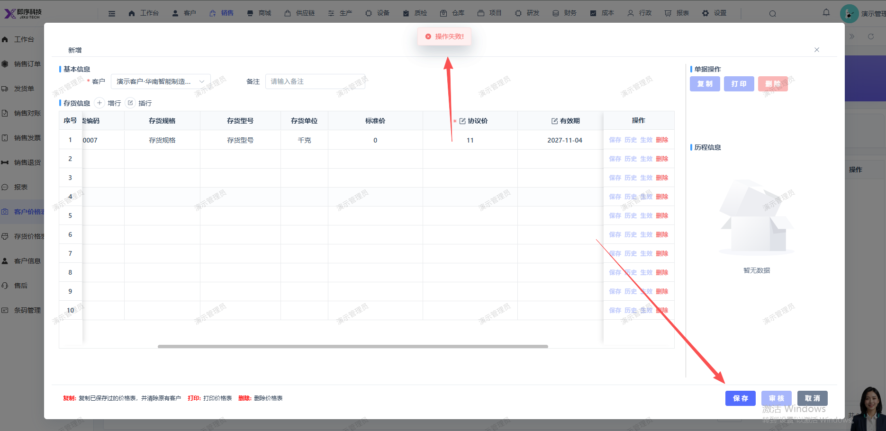

# 新增客户价格表， 保存时报：操作失败!

- **优先级**：P1
- **模块 / 页面**：销售-客户价格表
- **测试环境**：https://jixu-ai.com/erp/sale/customerPrice
- **提交时间**：2026-11-04 16:22:44（北京时间）
- **状态**：待修复

## 问题描述
新增客户价格表， 保存时报：操作失败!

## 复现步骤
1，点击销售
2，点击客户价格表
3，点击新增，在弹窗页面选择存货，填写协议价，点击保存后报错：操作失败!

## 实际结果

## 预期结果

## 截图

