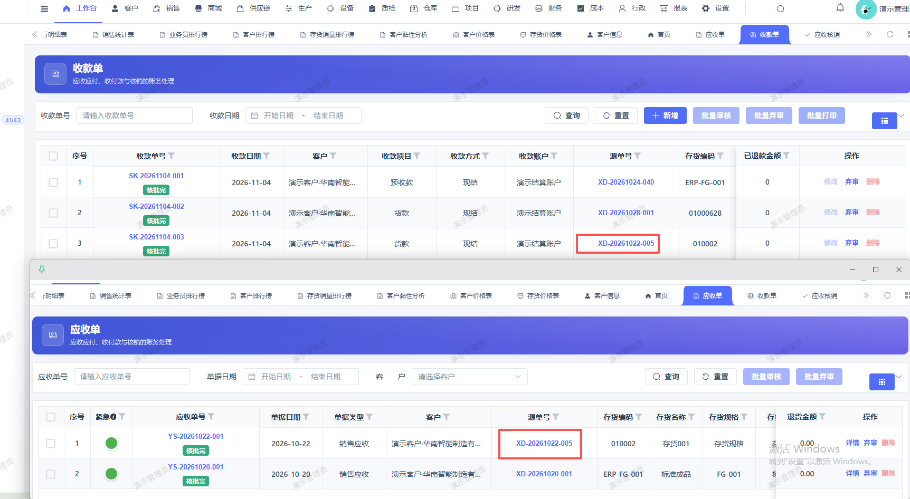
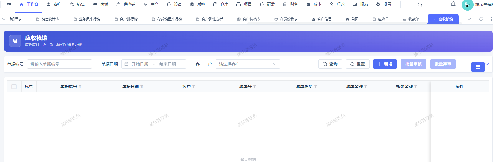

# 应收单和收款单已审核通过，未自动核销生成应收核销单

- **优先级**：P1
- **模块 / 页面**：财务-往来财务-应收管理
- **测试环境**：https://jixu-ai.com/finance/receivableManage/recWriteOff
- **提交时间**：2026-11-04 16:49:57（北京时间）
- **状态**：待修复

## 问题描述
应收单和收款单已审核通过，未自动核销生成应收核销单

## 复现步骤
1，点击财务
2，点击往来财务
3，点击应收管理，无自动核销生成应收核销单
应收单号：YS-20261022-001
收款单号：SK-20261104-003

## 实际结果

## 预期结果

## 截图

