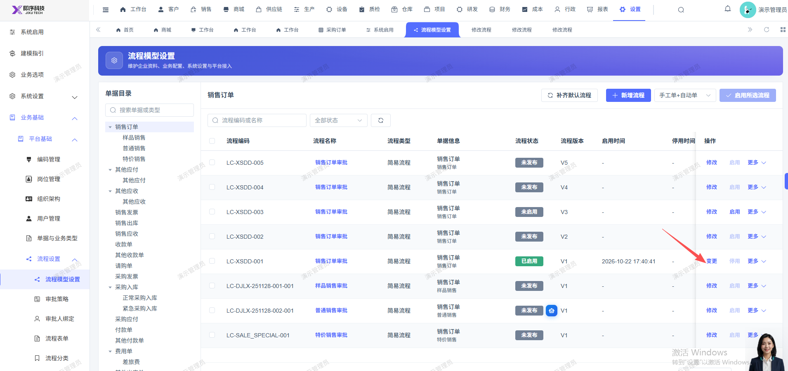

# 销售订单流程模型，流程已启用，点击变更，就会新增一个流程模型

- **优先级**：P2
- **模块 / 页面**：设置-业务基础-平台基础
- **测试环境**：https://jixu-ai.com/settings/bpm/model-settings
- **提交时间**：2026-11-05 11:00:20（北京时间）
- **状态**：待修复

## 问题描述
销售订单流程模型，流程已启用，点击变更，就会新增一个流程模型

## 复现步骤
1，点击设置
2，点击业务基础
3，点击平台基础
4，点击销售订单
5，流程编号：LC-XSDD-001  --流程已启用，点击变更，就会新增一个流程模型

## 实际结果

## 预期结果

## 截图

