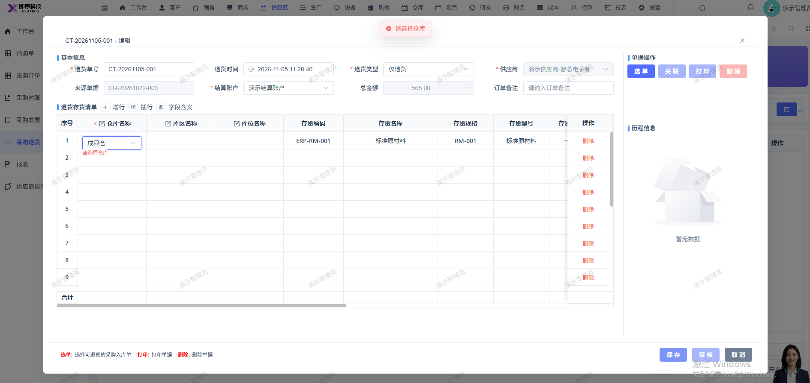

# 采购退货保存报错：请选择仓库，已有仓库提示请选择仓库

- **优先级**：P1
- **模块 / 页面**：供应链-采购退货
- **测试环境**：https://jixu-ai.com/erp/purchase/return
- **提交时间**：2026-11-05 11:32:40（北京时间）
- **状态**：待修复

## 问题描述
采购退货保存报错：请选择仓库，已有仓库提示请选择仓库

## 复现步骤
1，点击供应链
2，点击采购退货
3，点击新增
4，点击选单，在弹窗内选择采购订单：CR-20261022-003，点击确定；再点击保存

## 实际结果

## 预期结果

## 截图

