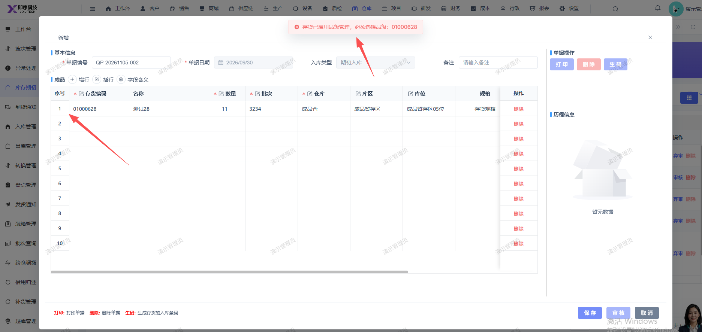

# 期初数据新增，选中存货01000628保存时提示：必须选择品级，页面无选择品级字段

- **优先级**：P2
- **模块 / 页面**：仓库-库存期初
- **测试环境**：https://jixu-ai.com/wireSideWarehouse/beginningInventory
- **提交时间**：2026-11-05 15:53:21（北京时间）
- **状态**：待修复

## 问题描述
期初数据新增，选中存货01000628保存时提示：必须选择品级，页面无选择品级字段

## 复现步骤
1，点击仓库
2，点击库存期初
3，点击新增，点击存货编码，选择存货编码：01000628，点击确定后；输入数量，批次，点击保存，报错：存货已启用品级管理，必须选择品级：01000628

## 实际结果

## 预期结果

## 截图

