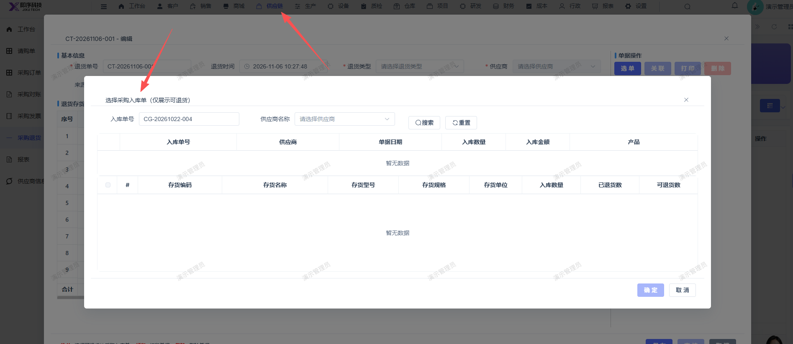

# 新建采购退货单，选单时弹窗页面应显示符合的采购订单，而不是采购入库单

- **优先级**：P1
- **模块 / 页面**：供应链-采购退货
- **测试环境**：https://jixu-ai.com/erp/purchase/return
- **提交时间**：2026-11-06 10:41:30（北京时间）
- **状态**：代码已修复，待发布

## 问题描述
新建采购退货单，选单时弹窗页面应显示符合的采购订单，而不是采购入库单

## 复现步骤
1，供应链
2，采购退货
3，新建采购退货单，选单时弹窗页面应显示符合的采购订单，而不是采购入库单

## 实际结果

## 预期结果

## 截图

## 状态同步（Codex，2026-11-06）

- 产品提交：[前端 1e705bdb0](http://192.168.110.240:3008/cfor_front/cfor-admin-vue3/-/commit/1e705bdb0b2085616513c19225938af416f9537e)
- 合入分支：dev/develop_5.0.1；本次已刷新远端并核对提交祖先关系。
- 当前结论：代码已修复，待发布；已有本地验证记录，生产发布和修复后生产复测尚无证据。
- 详细记录：[修改内容、验证及限制](reports/2026-11-06-today-bug-status-sync.md#bug-local-20261106104130-9aed853e)
