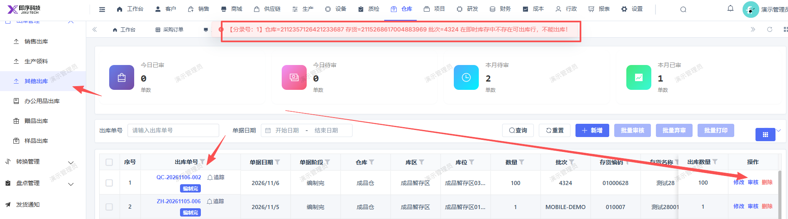

# 其他出库审核报错，无法审核出库；同时提示语应修改，仓库和存货名称未正确显示

- **优先级**：P1
- **模块 / 页面**：仓库-其他出库
- **测试环境**：https://jixu-ai.com/wireSideWarehouse/out/outOther
- **提交时间**：2026-11-06 10:58:32（北京时间）
- **状态**：待修复

## 问题描述
其他出库审核报错，无法审核出库；同时提示语应修改，仓库和存货名称未正确显示：【分录号：1】仓库=2112357126421233687 存货=2115268617004883969 批次=4324 在即时库存中不存在可出库行，不能出库！

## 复现步骤
1，点击仓库
2，点击出库管理
3，点击其他出库
4，选择出库单号：QC-20261106-002，点击右侧操作栏：审核，报错：【分录号：1】仓库=2112357126421233687 存货=2115268617004883969 批次=4324 在即时库存中不存在可出库行，不能出库！

## 实际结果

## 预期结果

## 截图

