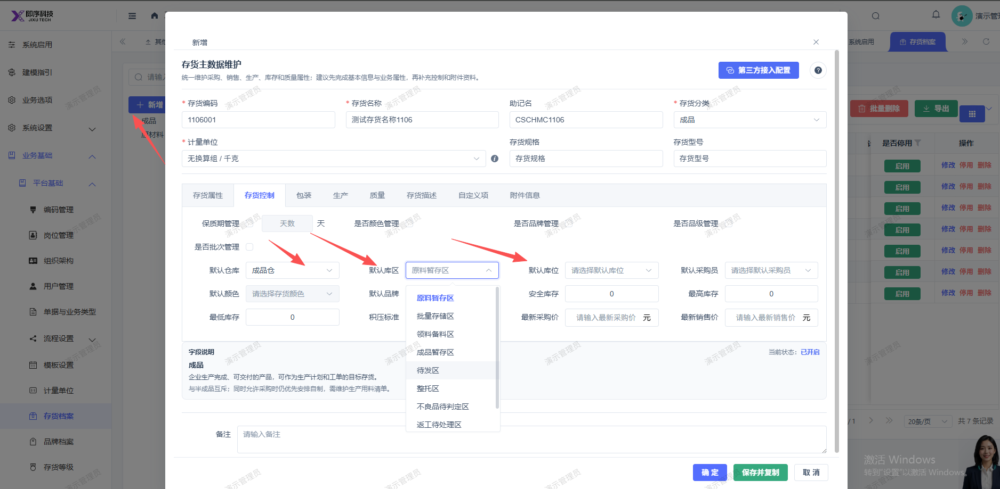
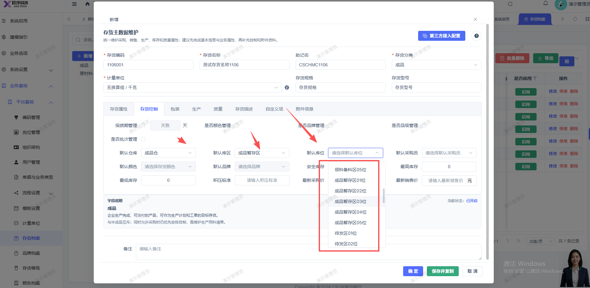

# 新增存货页面，选择了仓库，对应的库区库位应对应显示，不要显示所有的库区库位

- **优先级**：P2
- **模块 / 页面**：设置-业务基础-平台基础
- **测试环境**：https://jixu-ai.com/settings/erp/material
- **提交时间**：2026-11-06 15:49:48（北京时间）
- **状态**：待修复

## 问题描述
新增存货页面，选择了仓库，对应的库区库位应对应显示，不要显示所有的库区库位；成品仓，显示成品库区库位

## 复现步骤
1，点击设置
2，点击业务基础
3，点击平台基础
4，点击存货档案
5，点击新增，在弹窗页面点击存货控制，选择了仓库，对应的库区库位应对应显示，不要显示所有的库区库位；成品仓，显示成品库区库位

## 实际结果

## 预期结果

## 截图

