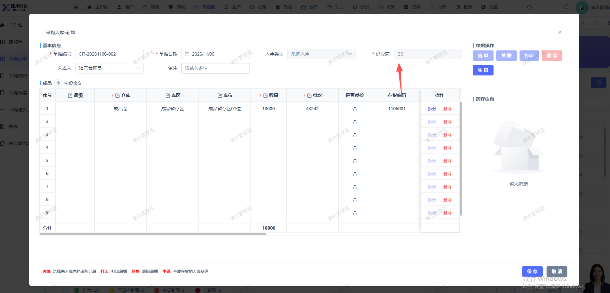
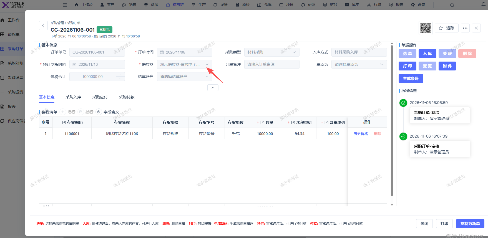

# 采购入库详情页面，供应商名称未显示

- **优先级**：P2
- **模块 / 页面**：仓库-入库管理
- **测试环境**：https://jixu-ai.com/wireSideWarehouse/in/inPurchase
- **提交时间**：2026-11-06 16:10:34（北京时间）
- **状态**：待修复

## 问题描述
采购入库详情页面，供应商名称未显示

## 复现步骤
1，点击仓库
2，点击入库管理
3，点击采购入库
4，点击单据编号：CR-20261106-002 ，情页面，供应商名称未显示

## 实际结果

## 预期结果

## 截图

