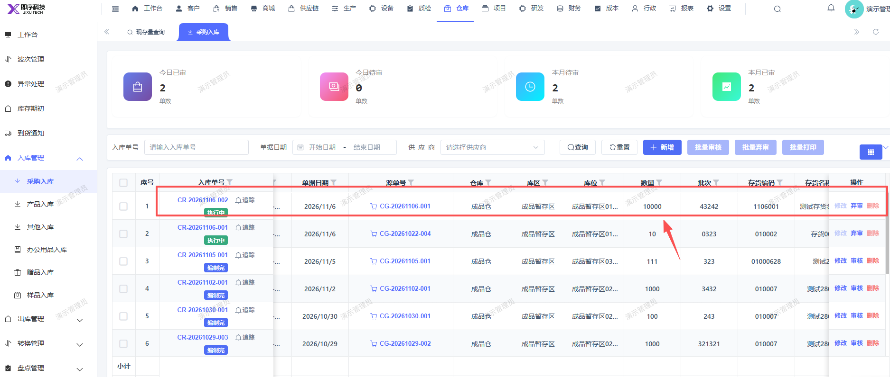

# 采购入库单据审核通过，现存量报表的现存量和可用量应一起写入，现在可用量没有写入

- **优先级**：P1
- **模块 / 页面**：仓库-报表
- **测试环境**：https://jixu-ai.com/wireSideWarehouse/reportForms/standingStock
- **提交时间**：2026-11-06 16:39:40（北京时间）
- **状态**：待修复

## 问题描述
采购入库单据审核通过，现存量报表的现存量和可用量应一起写入，现在可用量没有写入

## 复现步骤
1，点击仓库
2，点击报表
3，点击现存量查询，搜索存货编码1106001，现在可用量没有写入（采购入库单据审核通过，现存量报表的现存量和可用量应一起写入，采购入库单号是：CR-20261106-002）

## 实际结果

## 预期结果

## 截图

