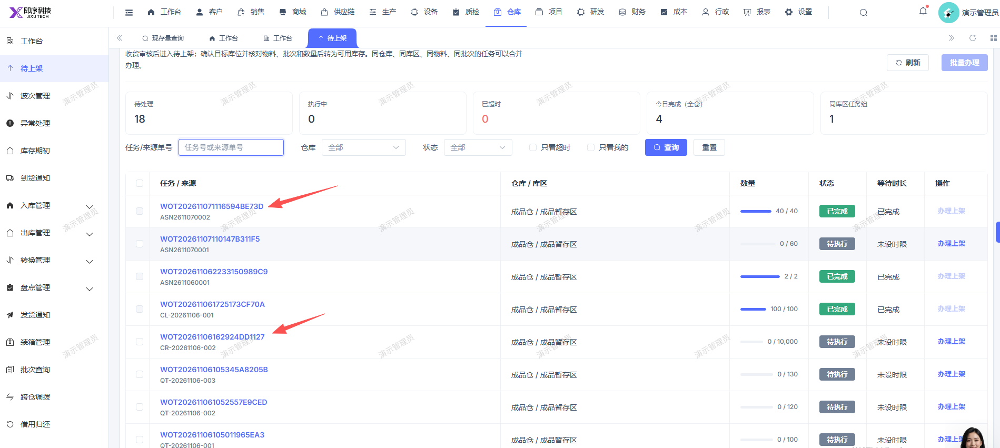

# 待上架页面，WOT202611071116594BE73D这排应显示任务的名称为入库类型

- **优先级**：P2
- **模块 / 页面**：仓库-待上架
- **测试环境**：https://jixu-ai.com/wireSideWarehouse/putaway
- **提交时间**：2026-11-07 15:26:19（北京时间）
- **状态**：待修复

## 问题描述
待上架页面，WOT202611071116594BE73D这排应显示任务的名称为入库类型

## 复现步骤
1，点击仓库
2，点击待上架
3，任务/来源列，任务WOT202611071116594BE73D这排应显示任务的名称为入库类型

## 实际结果

## 预期结果

## 截图

