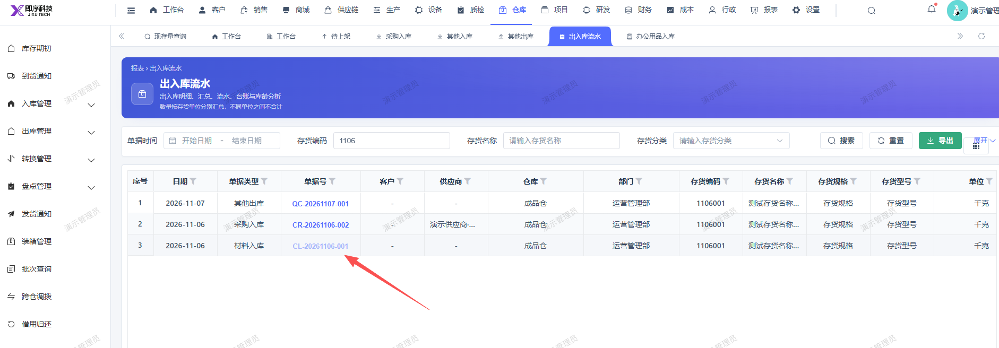

# 出入库流水页面的，办公用品入库对应的单据号点击无法显示详情

- **优先级**：P2
- **模块 / 页面**：仓库-报表
- **测试环境**：https://jixu-ai.com/wireSideWarehouse/reportForms/inOutStream
- **提交时间**：2026-11-07 15:50:03（北京时间）
- **状态**：代码已修复，待发布

## 问题描述
出入库流水页面的，办公用品入库对应的单据号点击无法显示详情

## 复现步骤
1，点击仓库
2，点击报表
3，点击出入库流水，单据号：CL-20261023-001点击无法显示详情

## 实际结果

## 预期结果

## 截图

## 状态同步（Qoder，2026-11-10）

- 产品提交：[前端 a643677b5](http://192.168.110.240:3008/cfor_front/cfor-admin-vue3/-/commit/a643677b572a3af0287a7371128b2ffebb72f00b)
- 合入分支：dev/develop_5.0.1；本次已刷新远端并核对提交祖先关系。
- 原因：流水页 `formDialogRefs` 缺少办公用品入库的 107，`formDialogRefs[row.stockIoType]` 取不到 ref，可选链静默跳过 `open(...)`，因此点击无弹窗。专用详情组件本身已存在。
- 修改：改前端代码，未改后端、配置或数据库结构。流水页 `index.vue` 引入并挂载 `FormDialogOfficeIn`、声明 ref、将 107 登记到 `formDialogRefs`；办公用品入库 `components/formDialog.vue` 将读取详情后覆盖 `isDetail` 的语句改为 `isInfo || dialogData.formData.billStage > 14`，避免编制完单据覆盖传入的只读标志。
- 既有验证及限制：本地新增并保存测试单 CL-20261109-001（类型 107、编制完，备注明确标记本地复测无真实交易），**保留该测试单、未审核**，未改主数据。流水页点击该单号正常显示详情与明细，底部只有「关闭、打印」，可见且可编辑的输入框数为 0；同页采购入库 CR-20261104-002 回归正常。两文件 Vue SFC 编译、ESLint、`git diff --check` 通过，**未执行全项目 vue-tsc**。**线上仅用于原始复现（只读点击原单 CL-20261023-001），修复复测全部在本地，未部署线上。**本地筛选「办公用品入库」原无数据，未假称本地原单复现。
- 当前结论：代码已修复，待发布；尚无生产发布或修复后生产复测证据。
- 详细记录：[修改内容、验证及限制](reports/2026-11-10-bug-status-sync.md#bug-local-20261107155003-fcc176eb)
