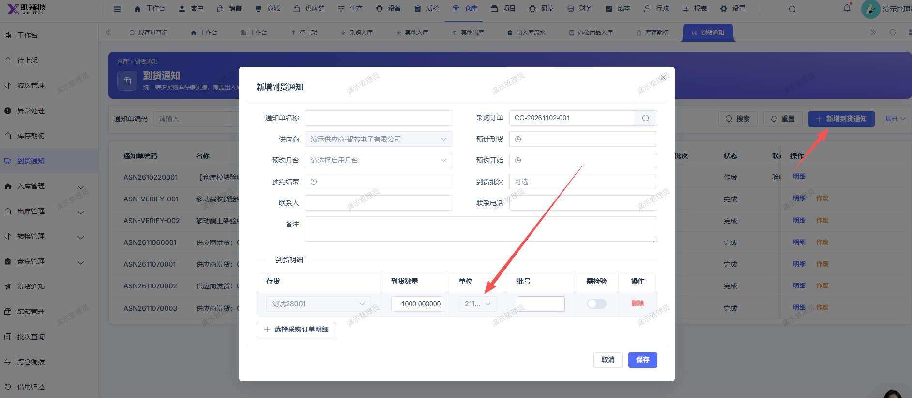

# 新增到货通知页面，选择采购订单后，对应存货单位未显示正确

- **优先级**：P2
- **模块 / 页面**：仓库到货通知
- **测试环境**：https://jixu-ai.com/wireSideWarehouse/arrivalNotice
- **提交时间**：2026-11-07 16:07:39（北京时间）
- **状态**：代码已修复，待发布

## 问题描述
新增到货通知页面，选择采购订单后，对应存货单位未显示正确

## 复现步骤
1，点击仓库
2，点击到货通知
3，点击新增到货通知
4，在弹窗选择采购订单CG-20261102-001，确认后，页面对应存货单位未显示正确

## 实际结果

## 预期结果

## 截图

## 状态同步（Qoder，2026-11-10）

- 产品提交：[后端 0209e5999](http://192.168.110.240:3008/cfor_backend/cfor-admin/-/commit/0209e59991b8759503bd8743b2b03f1e8fe2ac63)
- 合入分支：dev/develop_5.0.1；本次已刷新远端并核对提交祖先关系。
- 原因：单位下拉用的字典 `mes_bas_unit,name,id` 未登记进后端动态字典目录白名单 `DynamicDictionaryQuery.catalogs()`，字典接口返回 500（`INVALID_QUERY`），前端取不到任何选项，el-select 回退把绑定值当文本显示。单位 ID 本身带入正确，缺的是字典选项。
- 修改：改后端代码（共享白名单增量扩展），未改前端。`catalogs()` 增登记 `mes_bas_unit`，label=name、value=id、无附加过滤、`shared=false`（按租户隔离）；同模块测试增 H2 表与数据及租户边界用例。
- 既有验证及限制：`mvn -pl cfor-module-system -Dtest=DynamicDictionaryQueryTest test` BUILD SUCCESS，Tests run 10、Failures 0、Errors 0。页面级复测两轮通过（2026-11-09）：新增到货通知→选 CG-20261104-003→确定带入，单位列显示「千克」，选项 5 项加载正常，**点取消未保存单据**。复测环境为 localhost:9152 + 48081，不是生产。报告点名的 CG-20261102-001 本地查无此单，改用同取数路径的 CG-20261104-003 复现。过程中的本地库补列与运行 args 调整属本地环境恢复，不是产品代码改动。
- 当前结论：代码已修复，待发布；尚无生产发布或修复后生产复测证据。
- 详细记录：[修改内容、验证及限制](reports/2026-11-10-bug-status-sync.md#bug-local-20261107160739-053bc7aa)
