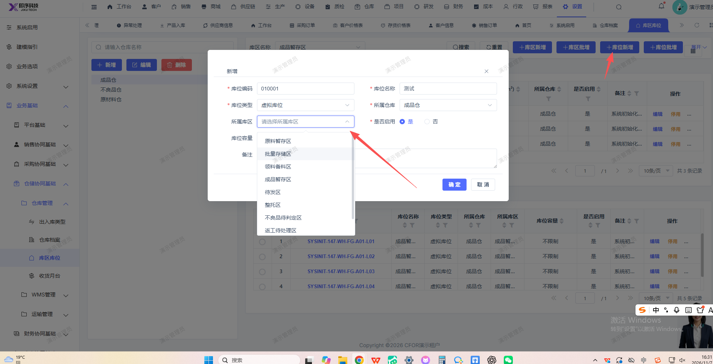

# 库位新增页面，选择仓库后，应显示对应的库区，不应显示全部的

- **优先级**：P2
- **模块 / 页面**：设置-业务基础-仓储协同基础
- **测试环境**：https://jixu-ai.com/settings/spec/locations
- **提交时间**：2026-11-07 16:50:41（北京时间）
- **状态**：待修复

## 问题描述
库位新增页面，选择仓库后，应显示对应的库区，不应显示全部的

## 复现步骤
1，点击设置
2，点击业务基础
3，点击仓储协同基础
4，点击仓库管理
5，点击库区库位
6，点击成品仓，再点击库位新增，在弹窗页面点击库区，不应显示全部的，应显示对应的

## 实际结果

## 预期结果

## 截图

